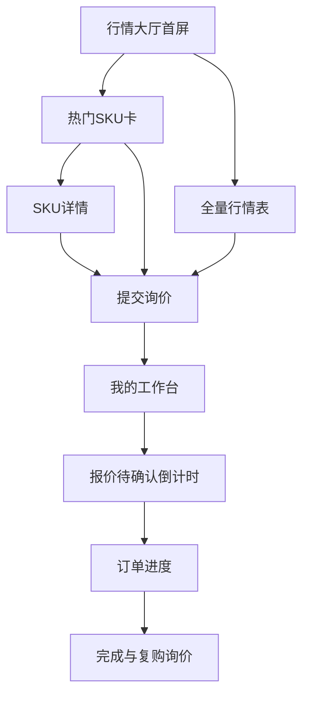
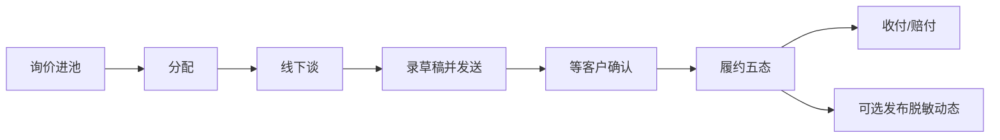

# CompriX 产品方案 V2（客户感知 × Broker 闭环）

> 已被 [`PRODUCT_V3.md`](./PRODUCT_V3.md) 吸收为「完整落地版」。本文保留作感知与页面溯源；**排期与模型以 V3 为准**。
>
> 目标：在**不破坏「人谈机记」MVP 原则**的前提下，把客户前台从「一张参考价表」升级成**看起来在成交、值得询价**的算力交易入口；后台补齐工作台节奏感。  
> 本文侧重**产品与页面**；数据模型 / API / SLA / 通知见 V3。

---

## 0. 问题诊断（现状为什么「不像火热平台」）

| 维度 | 现状 | 火热平台应有的感知 |
|------|------|-------------------|
| 首页 | 标题 + 筛选 + 表格 | 品牌与价值主张先行；供给/成交/响应速度可见 |
| 信息密度 | 只有价 | 价 + 库存意象 + 交期 + 热度 + 案例 |
| 情绪 | 后台报表感 | 行情板 / 交易大厅感 |
| 路径 | 看表 → 询价 | 发现 → 对比 → 询价 → 跟进 → 成交庆祝 |
| 社会证明 | 无 | 脱敏成交、响应 SLA、服务承诺 |
| 节奏 | 静态 | 今日行情、待办、报价倒计时 |

**原则**：用**真实或可运营的数据**制造「热闹」，禁止假造虚假实时聊天/虚假人数；可展示脱敏成交、官方统计、运营配置的通告。

---

## 1. 产品一句话（V2）

**CompriX = 算力行情与询价入口（C） + Broker 线下成交操作系统（B）。**  
客户感觉「这里有货、有人、有进度」；Broker 感觉「单子进得来、跟得住、账记得清」。

仍不做：自动撮合、链、IM、自动支付、AI 推荐（可作为远期选项，不进 V2 必做）。

---

## 2. 信息架构

### 2.1 客户前台（建议导航）

```
首页 / 行情大厅
算力目录（GPU / Token）
提交询价
我的工作台（询价 + 报价待办 + 订单）
服务与保障（静态页）
登录
```

### 2.2 Broker / Admin 后台（在现有 6 菜单上强化）

```
今日工作台（强化 Dashboard）
询价池（增强筛选/SLA）
报价与发送
订单履约
财务记账
行情与供给（SKU / 参考价 / 供应商）
运营配置（通告、首页模块开关）← V2 新增轻量
```

---

## 3. 客户前台：页面级方案

### 3.1 首页「行情大厅」（替换「只有一张表」）

**首屏（一个主叙事，避免仪表盘堆砌）**

- 品牌 **CompriX** 作为最大视觉信号（字标/短词，不要被副标题压过）
- 一句主张：例「GPU / Token 现货询价 · Broker 在线撮合」
- 一句支撑：例「2–6 小时口头反馈 · 正式报价 24h 有效」
- 主 CTA：**立即询价**；次 CTA：**查看今日行情**
- 主视觉：全幅机房/集群氛围底（真实摄影或克制抽象网点），**禁止**紫渐变/奶油风/密密报纸栏
- 首屏不堆：成交额统计条、地址、日程、多枚徽章

**首屏以下模块（按优先级）**

| # | 模块 | 内容 | 目的 |
|---|------|------|------|
| A | 今日脉搏 | 今日参考价更新时间、待处理询价数（可只显示区间文案「活跃」）、平均报价响应（运营配置或近 7 日统计） | 活跃感 |
| B | 热门 SKU 行情卡组 | 3–6 个旗舰 SKU：中位价、低–高 bar、较昨日涨跌（需后台昨日报价）、「询价」 | 替代纯表的第一印象 |
| C | 行情全表（收起/展开或次屏） | 现有表升级：类型、单位、低中高、近30日成交、交期提示、操作 | 专业用户深查 |
| D | 脱敏成交动态 | 「华东 · H100 · 包月 · 今日成交」（订单完成后自动/人工审核发布） | 社会证明 |
| E | 为什么选我们 | 3 条：真实 Broker、可追溯状态、对公结算记账（不做支付也可说清） | 信任 |
| F | 底部 CTA | 再推一次询价 | 转化 |

**交互**

- GPU / Token segment 仍保留，作用于 B+C
- SKU 行/卡片点击进入「SKU 详情」或直接带 `sku_id` 进询价
- 测试 SKU（名称含 `SKU-T-`）默认前台隐藏，或 `status=inactive` / `is_public=false`

### 3.2 SKU 详情页（新）

- SKU 名、规格、单位、今日参考区间可视化
- 近 30 日成交区间 + 简单历史参考（若有历史 reference_prices）
- 常见交期说明（运营文案）
- CTA：对该 SKU 询价
- 侧栏：相关 SKU /「Broker 会联系您确认机房与并发」

### 3.3 提交询价（改版）

**从「一张表单」→「两步简报」**

1. **需求摘要**：SKU、数量、时长、期望交付；右侧实时显示「参考中位价 × 数量」仅作参考脚注  
2. **联系与备注**：公司、姓名、手机（锁定）、预算、备注；提交成功页强化预期（2–6h）+ 跳转「我的工作台」

增加：

- 草稿本地保存（localStorage）防刷新丢失  
- 提交后短信/邮件已接则明确「通知已发送」

### 3.4 我的工作台（升级「我的订单」）

| 区块 | 内容 |
|------|------|
| 待办 | 「有 1 份报价待确认（剩 xx 小时）」强提醒 |
| 询价列表 | 状态色点 + 最近动态一句 |
| 订单列表 | 进度条缩略 + 成交价 |
| 空状态 | 引导去行情大厅，不要空白表 |

**询价详情 / 报价确认**

- 报价卡：价格、交付、脱敏供应商、有效期倒计时  
- 主按钮确认 / 次按钮拒绝 + 拒绝原因（选填，进备注）  
- 确认后跳转订单并展示「订单已生成」

**订单详情**

- 五态进度（现有）加强时间戳文案  
- 可展示 Broker 留言（来自 order_logs note，对客户可见勾选）

### 3.5 服务与保障（静态，运营可改）

履约流程、计费说明、验收与赔付口径（对应后台「赔付」）、联系方式/企业微信二维码位。

---

## 4. Broker 后台：页面级方案（与前台「热闹」对齐）

### 4.1 今日工作台

- KPI：今日询价、待处理、待发送报价、报价即将过期、本月 GMV（已有则强化视觉）  
- **行动队列**：超时未分配、超时未报价、客户未确认临期  
- 快捷：「录入参考价」「处理下一条询价」

### 4.2 询价池

- 左侧状态 + SLA 色（>4h 未报黄，>8h 红，阈值可配）  
- 详情抽屉保留；增加「客户侧可见摘要」预览（脱敏后长什么样）  
- 附件、微信纪要字段（已有附件则强化入口）

### 4.3 行情运营

- 参考价：批量按日录入；支持「标记首页热门」勾选 3–6 个 SKU  
- SKU：增加 `前台可见`、`排序权重`、`卖点一行`  
- 通告条：首页顶部一条运营公告（开/关 + 文案）

### 4.4 成交动态发布（可选开关）

订单→已完成时，生成候选「脱敏动态」：区域（供应商备注或手工）、SKU、成交类型；默认需 Broker **一键发布**到前台，防泄密。

---

## 5. 关键用户路径（V2）



Broker 侧：



---

## 6. 模块清单与分期

### Phase A — 客户感知升级（建议先做，解决「单调」）

1. 首页行情大厅信息架构（Hero + 热门卡 + 表 + 信任区）  
2. 热门 SKU / 前台可见 / 排序（后台字段）  
3. 我的工作台待办与报价倒计时  
4. 询价两步流与成功页  
5. 隐藏测试 SKU；首页通告条  
6. 视觉体系：字体、色板、首屏氛围（克制、交易感，非 SaaS 紫）

### Phase B — 热闹与信任数据

1. 脱敏成交动态（审核发布）  
2. 参考价涨跌（相对昨日）  
3. Dashboard SLA 队列  
4. SKU 详情页  

### Phase C — 效率与运营

1. 参考价批量录入  
2. 客户拒绝原因枚举  
3. Broker 对客户可见备注  
4. 简单运营配置页  

### 明确仍不做（沿用 PRD）

自动撮合、链、IM、App、多语言、支付宝自动对接、复杂供应商评分、SCU 折算。

---

## 7. 页面线框（客户首页）

```
┌─────────────────────────────────────────────────────────┐
│ CompriX        行情  询价  我的工作台     手机号  退出   │
├─────────────────────────────────────────────────────────┤
│ ■■■■■■■■■■■■■■■  全幅氛围底  ■■■■■■■■■■■■■■■■■■■■■■■ │
│   COMPRIX                                               │
│   GPU / Token 现货询价 · Broker 在线撮合                 │
│   [立即询价]  [查看今日行情]                             │
├─────────────────────────────────────────────────────────┤
│ 今日脉搏：参考价已更新 · 响应通常 2–6h · 通告文案…      │
├───────────────┬───────────────┬─────────────────────────┤
│ 热门 H100     │ 热门 H800     │ 热门 Token              │
│ ¥ mid  低-高  │ …             │ …   [询价]              │
├─────────────────────────────────────────────────────────┤
│ 筛选 GPU|Token     完整行情表（现表升级）                 │
├─────────────────────────────────────────────────────────┤
│ 脱敏成交动态 | 星河·H100·包月 · 今日                     │
├─────────────────────────────────────────────────────────┤
│ 服务承诺三则                                              │
└─────────────────────────────────────────────────────────┘
```

---

## 8. 内容与运营依赖（「热闹」的真实燃料）

没有运营内容，再漂亮也是空壳。上线前准备：

- 6 个首页热门 SKU + 卖点一行文案  
- 当日参考价全量维护（已有能力）  
- 1 条通告（库存/交期提醒）  
- 3–5 条可发布的脱敏成交（可用 demo seed）  
- 服务与保障页法务口径一审  

---

## 9. 成功指标（产品）

| 指标 | 说明 |
|------|------|
| 询价转化率 | 访问行情 → 提交 RFQ |
| 报价确认率 | 发送报价 → 确认 |
| 待办触达 | 有 pending 报价的用户回访确认占比 |
| 感知 | 内测 5 人「是否像在运营的交易入口」主观分 |

---

## 10. 建议决策

1. **先做 Phase A**（主要改客户前台 IA + 视觉 + 热门/工作台），后台只加「热门/可见/通告」最小字段。  
2. Phase B 用真实成交与涨跌把「热闹」做实。  
3. 自动撮合等继续冻结。

确认本方案后，可按 Phase A 拆页面稿与开发任务落地。
